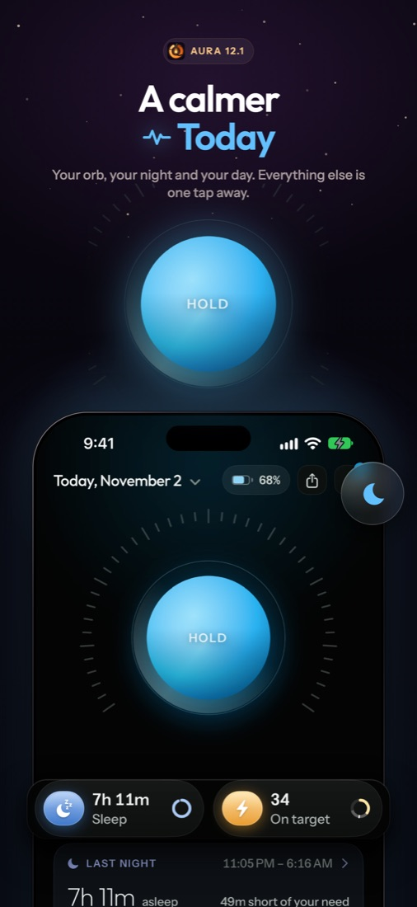
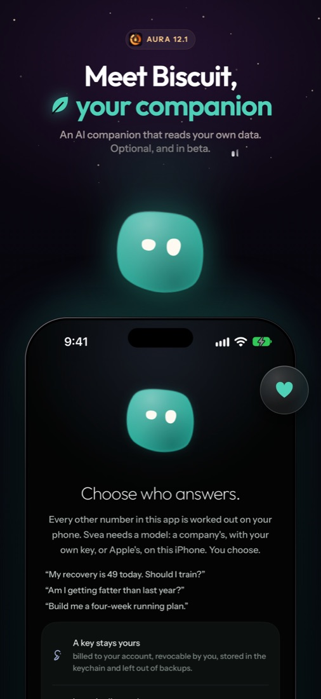
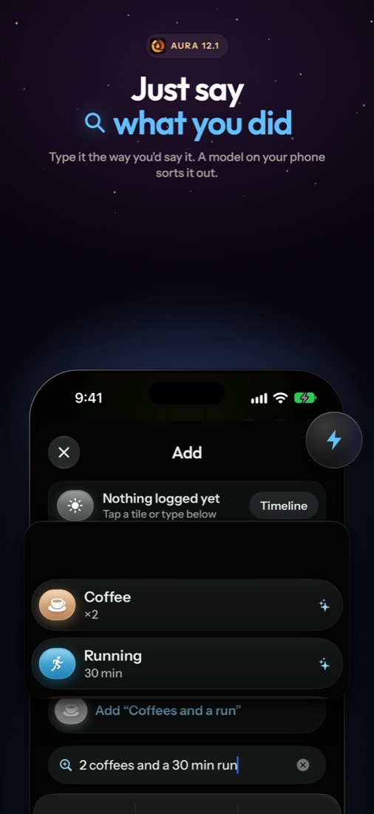
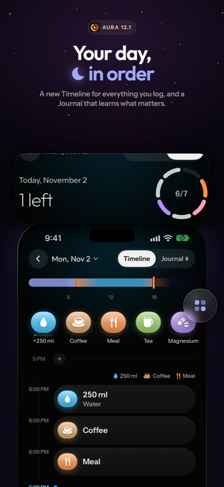
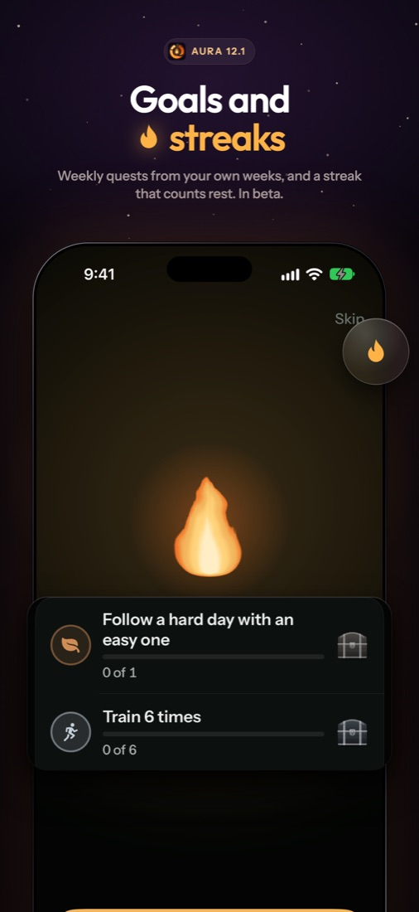
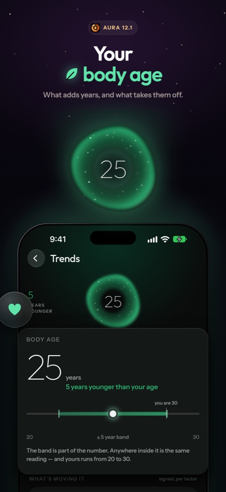

# Aura: private health tracking for iPhone

*Your health, understood. Privately.* · **[gdorgian.github.io/aura](https://gdorgian.github.io/aura/)**

Aura is a free health app for iPhone that helps you sleep better, recover smarter, train with purpose and see how you're aging, one day at a time. It tracks sleep, recovery, HRV, strain and body age from your wearable, smart scale and Apple Health.

Everything is worked out on your phone and stays there. No account, no subscription, no cloud.

  
  
  

  
  
  

- **Sleep and recovery:** how well you rested, and what it means for today.
- **Your body age:** what adds years, and what takes them off.
- **Training:** sessions, routines, routes and your progress, with Strava and Hevy.
- **Log anything:** type it the way you'd say it. Aura sorts it out on your phone.
- **Your journey:** goals, streaks, bloodwork, weight and a daily journal.
- **Biscuit:** an optional AI companion that reads your own data.

Aura reads heart-rate straps and smart scales, and brings in your history from other apps and devices. Every release goes further.

## FAQ

**Does it work with WHOOP? Do I need a WHOOP membership?**
Aura reads WHOOP 4.0, 5.0 and MG straps directly over Bluetooth, with no WHOOP membership or subscription. It never logs in to a WHOOP account or a WHOOP server.

**Which devices work?**
WHOOP 4.0, 5.0 and MG straps, 38 Bluetooth smart scales, and Apple Health. Aura also brings in your history from Strava, Hevy and other apps.

**What does it track?**
Sleep stages and sleep score, recovery, HRV, resting heart rate, strain, workouts, SpO₂, skin temperature, body age, weight and bloodwork.

**Is it free? Is it on the App Store?**
Free, with no ads and no account. It isn't on the App Store: you install the IPA with SideStore, AltStore or Sideloadly.

**Does my data leave my phone?**
Your health data is worked out and kept on your iPhone. Apple Health, Strava, Hevy and the optional Biscuit AI get data only if you turn them on.

**[Download Aura](https://github.com/gdorgian/aura/releases/latest)**: install the IPA with your usual sideloading tool. Updates arrive inside the app from then on.

Questions and bug reports: [Issues](https://github.com/gdorgian/aura/issues).

Aura is not a medical device. Unofficial: not made by or affiliated with WHOOP, Inc. Built on [NOOP](https://github.com/ryanbr/noop). See [LICENSE](LICENSE) and [NOTICE](NOTICE).
